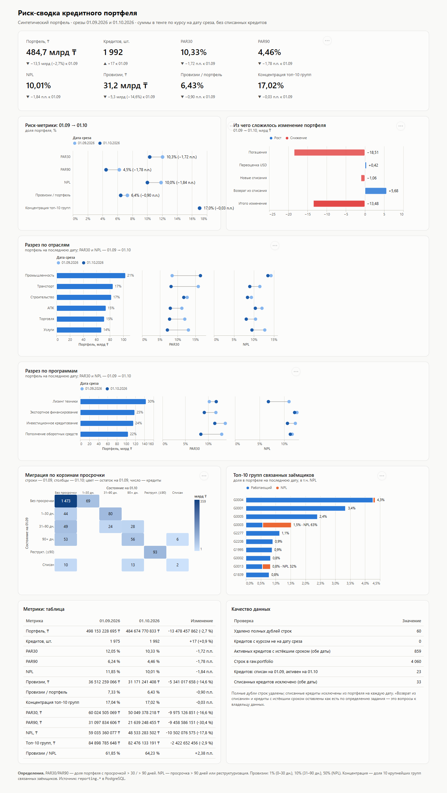

# Риск-сводка кредитного портфеля

PostgreSQL 16 → семантическая модель YAML → дашборд Vega-Lite по синтетическому портфелю
на два среза: **01.09.2026** и **01.10.2026**.



## Итоговые цифры

Портфель — в тенге по курсу на дату среза (USD: 478,35 и 482,10), без списанных кредитов.

| Метрика | 01.09.2026 | 01.10.2026 | Изменение |
|---|---:|---:|---:|
| Портфель | 498,15 млрд ₸ | 484,67 млрд ₸ | −13,48 млрд ₸ (−2,7%) |
| Кредитов в портфеле | 1 975 | 1 992 | +17 |
| PAR30 | 12,05% | 10,33% | −1,72 п.п. |
| PAR90 | 6,24% | 4,46% | −1,78 п.п. |
| NPL (90+ или реструктуризация) | 11,85% | 10,01% | −1,84 п.п. |
| Провизии | 36,51 млрд ₸ | 31,17 млрд ₸ | −5,34 млрд ₸ (−14,6%) |
| Провизии / портфель | 7,33% | 6,43% | −0,90 п.п. |
| Провизии / NPL | 61,85% | 64,23% | +2,38 п.п. |
| Концентрация топ-10 групп | 17,04% | 17,02% | −0,03 п.п. |

Точные значения: [`checks/sql_metrics.csv`](checks/sql_metrics.csv) (выгрузка `reporting.v_portfolio_metrics`).

## Три вывода для риск-комитета

1. **Улучшение NPL (−1,84 п.п.) пока нельзя считать устойчивым.** Оно держится на нетипично
   быстрых «излечениях»: за месяц 53 кредита из 90+ дней и 49 кредитов из 31–90 дней ушли в
   «без просрочки» (35,5 млрд ₸ на 01.09). Одновременно 23 кредита, списанные на 01.09, снова
   числятся активными (+5,7 млрд ₸ к портфелю, 13 из них сразу в 90+). Без них NPL на 01.10 был бы
   9,51%. **Предлагаю:** до признания улучшения проверить источник излечений
   (погашение, реструктуризация без флага или ошибка данных) и процедуру возврата из списания.
2. **Ранняя просрочка ускоряется, и это опережающий сигнал.** 80 из 124 кредитов в корзине 1–30 дней
   (25,2 млрд ₸, ≈65% по числу) перешли в 31–90 дней, ещё 69 кредитов (18,6 млрд ₸) впервые вышли
   в просрочку. В «Промышленности», крупнейшей отрасли (21% портфеля), PAR30 вырос с 8,5% до 16,5%.
   При этом провизии упали на 14,6%. **Ожидаю** рост PAR90/NPL через 1–2 месяца. **Предлагаю:**
   отдельный мониторинг корзины 31–90 и промышленного сегмента, оценить достаточность провизий.
3. **Концентрация стабильна (17,0%), но в верхушке сидит плохое качество.** Группа **G0003**
   (4-я по размеру, 1,5% портфеля) на 63% состоит из NPL (4,7 млрд ₸). **G0013** впервые вошла в
   топ-10, NPL 32%. Три крупнейшие группы — 10,1% портфеля (49 млрд ₸). **Предлагаю:**
   индивидуальный пересмотр G0003 и G0013, проверить лимиты на группу связанных заёмщиков.

Портфель снизился на 13,5 млрд ₸ в основном за счёт погашений (−18,5 млрд). Переоценка USD дала
+0,4 млрд, новые списания −1,1 млрд, возврат из списания +5,7 млрд (вью `reporting.v_portfolio_bridge`).
**Отдельный вопрос к данным:** у ≈20% портфеля (438 кредитов, 98 млрд ₸) срок погашения уже прошёл,
но у большинства из них просрочка 0 дней. Это либо пролонгации, не отражённые в данных, либо скрытая просрочка.

## Как запустить

Нужны PostgreSQL 16 (Docker или локальный), `bash` (Linux/macOS, на Windows — Git Bash) и Python 3.9+
(только для проверок, без сторонних пакетов).

```bash
git clone <repo-url> && cd <repo>
cp .env.example .env          # впишите свой пароль в PGPASSWORD
set -a; . ./.env; set +a

# 1. PostgreSQL 16 в Docker, порт открыт только на localhost
docker run -d --name risk-pg -e POSTGRES_PASSWORD="$PGPASSWORD" -e POSTGRES_DB="$PGDATABASE" \
  -p 127.0.0.1:${PGPORT}:5432 postgres:16

# 2. Сборка: схемы, загрузка CSV в raw, вьюхи reporting, тесты, выгрузка данных для дашборда
./scripts/build.sh            # если локального psql нет:
# PSQL="docker exec -i -e PGPASSWORD risk-pg psql -U postgres -d risk" ./scripts/build.sh

# 3. Независимая проверка цифр и семантической модели
./scripts/verify.sh

# 4. Дашборд: http://127.0.0.1:8000
python -m http.server 8000 --bind 127.0.0.1 --directory dashboard
```

Повторный запуск `build.sh` ничего не ломает и не дублирует. `raw` перезагружается через
`TRUNCATE + \copy` в одной транзакции, вьюхи создаются через `CREATE OR REPLACE VIEW`.
Дашборд читает готовые JSON из `dashboard/data/`, поэтому открывается и без базы.

> Проверено на PostgreSQL 16.11 (Windows, portable-сборка, `127.0.0.1:5433`) и Chrome.
> Docker на машине разработки не было, поэтому вариант через `docker run` выше в этой среде не запускался.

## Структура

```
data/                     portfolio.csv, fx.csv — исходные файлы
sql/00_schemas.sql        схемы raw, reporting
sql/01_raw_tables.sql     raw.portfolio, raw.fx — text-колонки «как в файле»
sql/02_reporting_views.sql вьюхи reporting (см. ниже)
sql/90_tests.sql          13 assert-проверок, при нарушении сборка падает
semantic/loan_portfolio.yaml     модель по кредитам (источник reporting.v_loan_portfolio)
semantic/portfolio_metrics.yaml  модель по датам (reporting.v_portfolio_metrics)
dashboard/specs/*.json    спеки Vega-Lite (7 штук)
dashboard/index.html      статичная страница, vega-embed
dashboard/data/*.json     выгрузка вьюх для дашборда (делает build.sh)
checks/reference_metrics.py   независимый пересчёт на чистом Python
checks/validate_semantic.py   валидация YAML и сверка с метриками
scripts/build.sh, verify.sh
CLAUDE.md, docs/AI_NOTES.md   инструкции ИИ-агенту, ошибки ИИ и исправления
```

| Вью `reporting.*` | Что внутри |
|---|---|
| `v_loan_snapshot` | очищенный срез: типы, удалены полные дубли, курс на дату среза, сумма в ₸, корзина DPD, флаги PAR/NPL, ставка провизии. Включает списанные (флаг) |
| `v_loan_portfolio` | **витрина**: только активные кредиты, аддитивные меры (`amount_kzt`, `par30_kzt`, `npl_kzt`, `provision_kzt`, `top10_group_kzt`) |
| `v_portfolio_metrics` | метрики по датам (одна строка на дату) |
| `v_portfolio_metrics_change` | метрики в длинном формате с изменением к базовой дате 01.09 |
| `v_portfolio_breakdown` | разрезы по отрасли / программе / валюте с изменением к 01.09 |
| `v_group_exposure` | экспозиция и ранг групп связанных заёмщиков |
| `v_dpd_migration` | матрица миграции между корзинами просрочки (roll rates) |
| `v_portfolio_bridge` | мост портфеля: погашения, переоценка, списания, возвраты |
| `v_data_quality` | сводка по качеству данных |

## Трактовки и допущения

- PAR и NPL считаются по сумме в тенге, а не по количеству кредитов. «Больше 30» значит строго `> 30`.
- Провизии: NPL → 50% (имеет приоритет, в том числе для реструктуризированных с DPD 0); иначе 31–90 дней → 10%;
  иначе 0–30 дней → 1%. Ровно 30 дней → 1%, ровно 90 дней → 10% и не NPL.
- Курс берётся на дату среза (`fx.date = report_date`). Если даты нет, берётся последний более ранний курс,
  но тест требует точного совпадения, поэтому пропуск курса остановит сборку. Это важно: 01.09 курс
  вырос на 1,03% за день (473,47 → 478,35), в 4 раза больше любого другого дневного движения в файле.
- Топ-10 групп определяется на каждую дату отдельно. Тест проверяет, что на границе десятки нет «ничьих».
- Списание определяется флагом на конкретную дату. Кредит, списанный на 01.09 и активный на 01.10,
  входит в портфель 01.10. Так требует определение, но влияние показано отдельно.
- Ratio-метрики в YAML нельзя выразить через `sum/avg` по строкам. Поэтому в модели по кредитам лежат
  аддитивные числители и знаменатель (ratio = sum / sum), а готовые ratio — в модели по датам.

## Качество данных

| Проверка | Значение |
|---|---:|
| Строк в `raw.portfolio` | 4 060 |
| Полных дублей удалено | 60 (по 30 на дату) |
| Списанных исключено | 25 на 01.09, 8 на 01.10 |
| Списан на 01.09 → активен на 01.10 | 23 |
| Активных кредитов с истёкшим сроком | 421 на 01.09, 438 на 01.10 (≈20% портфеля) |
| Кредитов без курса на дату среза | 0 |

## Как проверял, что цифры верны

1. **Два независимых расчёта.** [`checks/reference_metrics.py`](checks/reference_metrics.py) пересчитывает
   все метрики из CSV на чистом Python (`Decimal`, без SQL и без pandas). `verify.sh` сверяет результат с выгрузкой
   `v_portfolio_metrics`: суммы с точностью до 0,01 ₸, доли до 1e-9. Результат: **0 расхождений** на обе даты.
2. **13 SQL-тестов** ([`sql/90_tests.sql`](sql/90_tests.sql)) запускаются в каждой сборке. Проверяют уникальность
   ключа, отсутствие потерь строк, курс на дату среза для каждого кредита, неравенства
   `PAR90 ≤ PAR30 ≤ портфель`, `PAR90 ≤ NPL`, `1% ≤ провизии ≤ 50%`, что сумма разрезов равна итогу,
   что мост портфеля сходится, ровно 10 групп в топе и полноту матрицы миграции.
3. **Негативные тесты.** Специально ломал данные и проверял, что сборка падает с понятной ошибкой.
   Пойманы все 9 сценариев: неполный дубль ключа; нет курса на дату среза; дубль курса; отрицательная
   просрочка; неизвестная валюта (EUR); мусор в сумме; пустой флаг списания; флаг со значением «2»;
   «ничья» на границе топ-10 групп.
   В YAML битая колонка и недопустимый тип меры дают `SEMANTIC MODEL: FAILED`.
4. **Семантическая модель.** [`checks/validate_semantic.py`](checks/validate_semantic.py) проверяет структуру YAML и
   наличие колонок во вьюхе, а затем воспроизводит метрики мерами модели (`sum/sum`). Результат совпадает с вьюхой.
5. **Граничные случаи вручную.** DPD 30 → 1% и не PAR30, DPD 31 и 90 → 10%, реструктуризированный с DPD 0 → NPL 50%,
   USD-кредит L001563: 164 715,34 × 478,35 = 78 791 582,89 ₸.
6. **Идемпотентность и воспроизводимость.** Репозиторий клонирован в чистую папку и собран на новой пустой базе.
   Выгрузки совпали с закоммиченными. После трёх запусков подряд результат побайтово тот же, в `raw` по-прежнему 4 060 строк.
   Все 23 числа из этого README пересчитаны запросами к базе и сверены с текстом.
7. **Чувствительность к типичным ошибкам.** Показывает, что каждая ловушка в данных действительно меняет результат:

   | Ошибка | Портфель 01.09 | PAR30 01.10 |
   |---|---:|---:|
   | правильно | 498,15 млрд | 10,33% |
   | не удалить дубли | 512,42 млрд | 11,74% |
   | не исключить списанные | 504,66 млрд | 10,62% |
   | не конвертировать USD | 442,99 млрд | 10,59% |
   | `>= 30` вместо `> 30` | 498,15 млрд | 10,41% |
   | курс на 31.08 вместо 01.09 | 497,59 млрд | — |

   Концентрация по топ-10 **заёмщикам** вместо **групп** составила бы 10,99% / 10,93% вместо 17,04% / 17,02%.
   38 групп объединяют по 2–6 заёмщиков, поэтому ошибка в определении занизила бы риск концентрации на треть.

8. **Дашборд проверен глазами** по скриншоту. Так нашлись две ошибки сортировки, которые не дают
   никаких сообщений в консоли (см. [docs/AI_NOTES.md](docs/AI_NOTES.md)).

## Безопасность

- Секреты только в `.env`, файл в `.gitignore`. В репозитории лежит `.env.example` с плейсхолдером.
  Пароль нигде не захардкожен, скрипты берут его из стандартных `PG*` переменных.
- Порт Postgres публикуется только на `127.0.0.1`. Локальный кластер инициализирован с `scram-sha-256`.
- В SQL нет динамического SQL из внешнего ввода. Raw хранится как text, приведение типов идёт во вьюхах:
  «грязное» значение даст явную ошибку, а не тихую порчу.
- В дашборде Vega, Vega-Lite и vega-embed подключены с фиксированными версиями и **SRI-хэшами**. Задан
  Content-Security-Policy, JS вынесен в отдельный файл. Данные вставляются только через `textContent`. Кнопка
  «Open in Vega Editor» отключена: она отправляет спеку на внешний сайт. Локальный сервер слушает только `127.0.0.1`.
  `'unsafe-eval'` в CSP нужен самому Vega, который компилирует выражения.
- Данные синтетические, персональных данных нет.

## Работа с ИИ

Сделано в Claude Code. Инструкции для агента: [CLAUDE.md](CLAUDE.md). Где ИИ ошибся и что исправлено:
[docs/AI_NOTES.md](docs/AI_NOTES.md).
